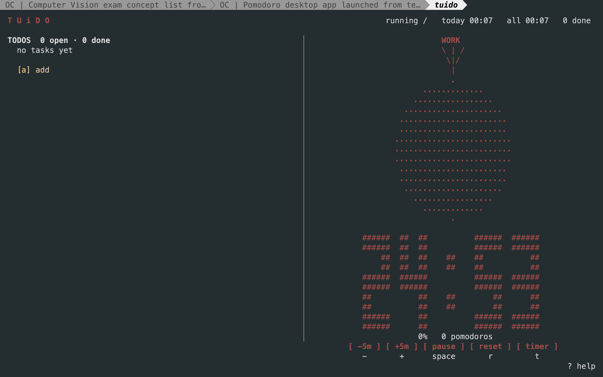

## Robert Paszek

Cognitive Science & AI at Tilburg University. I build developer tools and things
that have to survive contact with real data — scrapers, schedulers, 3D interfaces.
Mostly Rust, TypeScript and Python.

---

### [`TUiDO`](https://github.com/rpaszekdev/tuido) — terminal Pomodoro timer with a shared todo list

A single-file, dependency-free curses app: your tasks on the left, an ASCII
pomodoro that fills with `#` as the focus timer runs on the right. The same todo
list is exposed as a CLI, so an AI agent in another pane can add and check off
tasks while the timer keeps running — the TUI reloads live on every change. It
tracks daily focus time, logs sessions by day, and has an `i` ideas scratchpad.

`Python` · `curses` · `stdlib only`

---

### [`ctx`](https://github.com/rpaszekdev/ctx) — codebase context tracker, in Rust

Git tracks what your code *is*. `ctx` tracks what it *means*: a daemon parses every
save, diffs the symbols, and lets that heat ripple outward through the import graph
so you can see where the work is actually happening. Built to feed compact context
to AI coding agents instead of dumping the whole repo at them.

`Rust` · `ratatui` · `notify` · TypeScript / Rust / Python import resolution

---

### [`brain-quiz`](https://github.com/rpaszekdev/brain-quiz) — 3D neuroanatomy trainer → **[brainquiz.study](https://brainquiz.study)**

Learn the brain on a real WebGL brain rather than a flat diagram. 102 Desikan-Killiany
meshes, 49 clickable regions, and 32 quiz types **generated at runtime** from the
underlying data instead of an authored question bank. No login, no backend — it all
runs in the browser.

`Next.js 16` · `React 19` · `Three.js` · `Tailwind v4`

---

### [`OBSIDIAX`](https://github.com/rpaszekdev/OBSIDIAX) — tmux inside Obsidian

Real tmux panes in an Obsidian tab, plus a rail that lists every past Claude Code
session read straight off disk. Click a row and tmux splits open a pane already
resumed into that session. The PTY lives behind a swappable interface, because it
was the only part likely to break.

`TypeScript` · `xterm.js` · `node-pty` · Obsidian plugin API

---

Also on here: an <a href="https://github.com/rpaszekdev/openalex-mcp">OpenAlex MCP server</a> for scholarly search,
a <a href="https://github.com/rpaszekdev/autonomous_robot">conversational robot</a> from an Autonomous Systems course,
and <a href="https://github.com/rpaszekdev/Csai-">study tools</a> for the CSAI programme.
